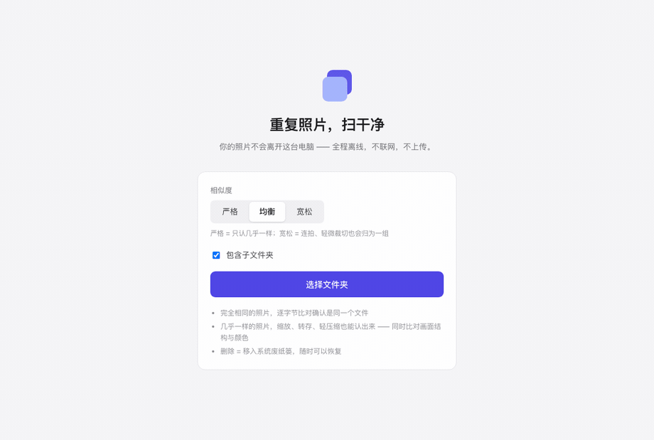
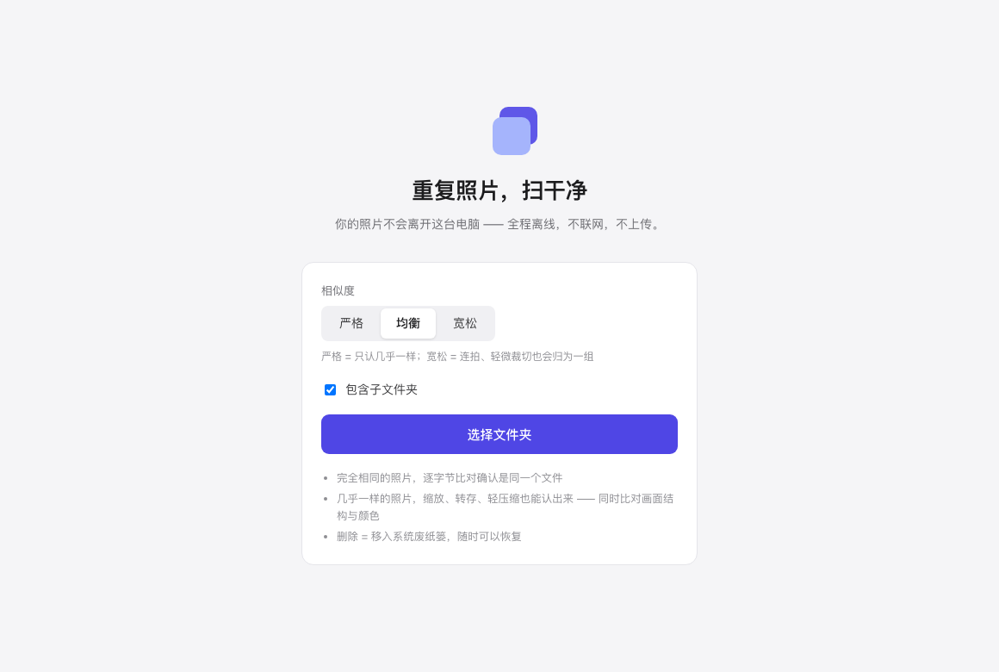
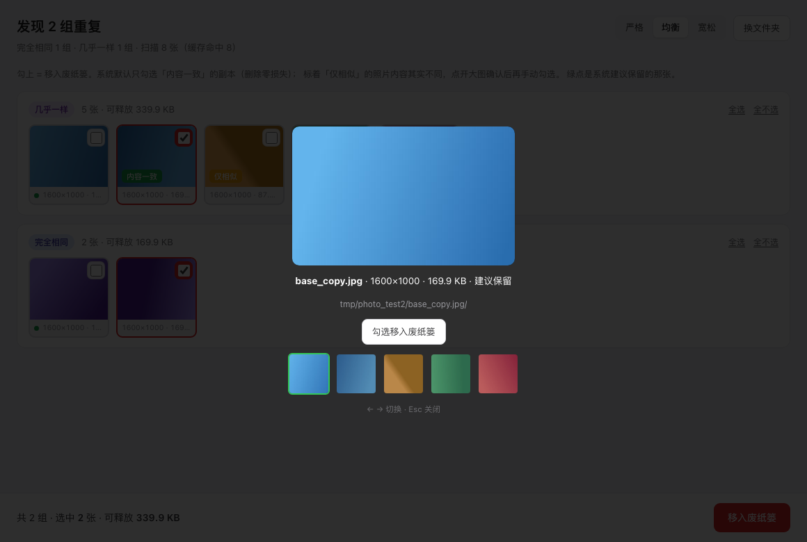

# dupRemove

**完全离线的 macOS 照片去重工具** — 选一个文件夹，找出重复和「几乎一样」的照片，分组预览、确认后再移入系统废纸篓。

> 当前 **Release：[v0.2.0](releases/tag/v0.2.0)**（预览版）。欢迎 [反馈 Issue](issues)。

## 预览

界面演示使用内置测试数据，与正式版 UI 一致。



| 空状态 | 分组结果 | 大图核对 |
|:---:|:---:|:---:|
|  |  |  |

---

## 适合谁

- 手机备份、导出、修图后文件夹里堆了大量**重复或连拍近似图**
- 不想把照片上传到任何「云去重」服务
- 希望**先看缩略图再决定删什么**，而不是黑盒一键清空

## 能做什么

| 能力 | 说明 |
|------|------|
| **精确去重** | 文件大小 + 内容哈希，找出完全相同的副本 |
| **相似去重** | 识别压缩、缩放、轻微编辑后的近似图（pHash + 颜色双校验） |
| **HEIC** | 支持 iPhone 常见的 HEIC（macOS 系统 ImageIO，本地解码） |
| **增量扫描** | 第二次扫同一文件夹只处理新增/变更文件，大库更省时间 |
| **智能保留** | 每组默认建议保留分辨率更高、信息更完整的那张 |
| **安全删除** | 仅移入**系统废纸篓**；二次确认 + **8 秒内可撤销** |
| **保守默认** | 只有「完全相同」会默认勾选删除；「仅相似」须你手动勾选 |
| **云端占位** | 自动跳过 iCloud / OneDrive 等未本地下载的占位文件，避免悄悄联网拉原图 |

相似度提供 **严格 / 均衡 / 宽松** 三档，切换后秒级重新分组。

## 怎么用

1. **选择文件夹**（可选是否包含子目录）→ 开始扫描  
2. **浏览分组**：缩略图对比、勾选要移走的项（可点大图核对「仅相似」组）  
3. **移入废纸篓** → 确认；误操作可在 **8 秒内撤销**

你的照片与指纹**始终只在本机**处理，应用不联网。

## 隐私承诺

1. **绝不联网** — 不上传、不统计你的照片内容  
2. **绝不硬删除** — 只进废纸篓，可在 Finder 里恢复  
3. **先预览后执行** — 未经确认不会动任何文件  

## 下载与安装

1. 在本仓库 **[Releases](releases)** 页下载 `dupRemove_*_aarch64.dmg`（Apple Silicon）。  
2. 打开 DMG，将 **dupRemove** 拖入 **应用程序**。  
3. **首次启动**：若提示「无法验证开发者」或「已损坏」（未 Apple 公证时常见）  
   - **推荐**：Finder 中 **右键 dupRemove → 打开 → 打开**  
   - 或终端：`xattr -cr /Applications/dupRemove.app`

## 系统要求

- **macOS**（建议 13 或更高）  
- **Apple Silicon**（M 系列）；Intel Mac 尚未提供构建  
- **格式**：JPEG、PNG、WebP、BMP、GIF、HEIC  

## 常见问题

**和「移到废纸篓」里手动删有什么区别？**  
dupRemove 先帮你**分组、预览、推荐保留项**，适合成库清理；删除方式与 Finder 一致，都在废纸篓。

**会误删吗？**  
「仅相似」默认不勾选；删除前有确认，且有 8 秒撤销。仍建议对相似组看一眼大图再删。

**数据存在哪？**  
扫描指纹与缩略图缓存在本机应用数据目录；不离开你的 Mac。

## 路线图

版本号以 [Releases](releases) 为准（`package.json` / 安装包同步）。下表是**产品阶段**，不等于已发布的 tag。

| 阶段 | 版本号 | 说明 |
|------|--------|------|
| **已发布** | **v0.2.x** | 预览：CI、删除确认 Esc、扫描统计、缩略图缓存淘汰（[v0.2.0](releases/tag/v0.2.0)） |
| **已发布** | **v0.1.x** | 首版预览（[v0.1.0](releases/tag/v0.1.0)） |
| **规划** | **v1.0.0** | 正式 MVP：承诺冻结 + 双机验收；公证可选 |
| **规划** | **v1.1** | 镜像容错、Intel / Universal（视需求） |
| **规划** | **v1.2** | 多文件夹、过滤规则、自定义保留策略 |
| **更远** | — | Windows 版等 |

下一版任务清单与验收见 **[docs/06-v0.2-规划.md](docs/06-v0.2-规划.md)**。

---

## 开发者

从源码构建（需 Node、Rust、Xcode 命令行工具）：

```bash
npm install
npm run tauri dev    # 开发
npm run check        # 门禁：前端构建 + fmt + clippy + 测试
npm run release      # 产出 DMG（见 bundle/dmg/）
```

设计与实现文档：[docs/](docs/)（产品方案、架构、路线图）。
