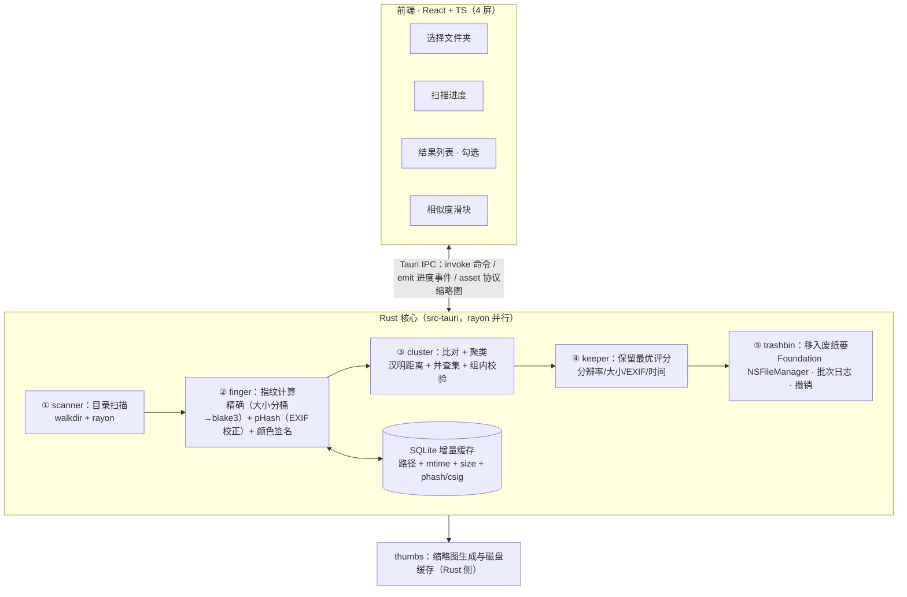

# 架构设计与模块划分

## 一、总体架构



## 二、Rust 模块职责

| 模块 | 职责 | 关键依赖 |
|---|---|---|
| `scanner` | 遍历、格式过滤、跳过 OneDrive/iCloud 占位文件 | walkdir、rayon |
| `finger` | 精确指纹（大小分桶→blake3）+ pHash（EXIF 方向校正）+ 颜色签名 | image、kamadak-exif、blake3 |
| `store` | SQLite 增量缓存读写 | rusqlite |
| `cluster` | 暴力汉明比对 + 并查集聚类 + 组内一致性校验（超界拆组） | 纯 Rust，无依赖 |
| `keeper` | 保留最优评分（分辨率 → 大小 → EXIF → 时间） | kamadak-exif |
| `trashbin` | 移废纸篓（Foundation NSFileManager）+ 批次日志 + 会话内撤销 | objc2-foundation |
| `thumbs` | 缩略图生成、落盘缓存、经 asset 协议供前端加载 | image |

每个模块可独立单元测试。`cluster` 是纯函数式模块，无任何 I/O，测试成本最低、收益最高。

## 三、核心算法决策记录

1. **相似比对：暴力汉明，不用 LSH**
   - 5 万张 ≈ 1.25×10⁹ 对，popcount 单指令，rayon 并行 <1 秒
   - 零漏报（原 LSH 4×16 分桶在阈值 >3 时存在漏报，见评审文档问题 1）
   - 超过 20 万张时迁移 BK-tree
2. **聚类：并查集 + 组内一致性校验**，防链式合并产生"不像"的同组照片
3. **精确去重：大小分桶 → blake3**（放弃 SHA-256，非安全场景快 3–5 倍足够）
4. **相似判定：pHash（64 位）+ 颜色签名（48 字节网格）双闸门**，解码后先按 EXIF 方向校正，结构距离与颜色距离都过阈值才算「几乎一样」（2026-10-28 起为实际实现，替代原 dHash 方案）
5. **增量缓存键**：`路径 + mtime + size`，命中则跳过指纹计算。已知精度限制（mtime 截断到秒、无算法版本号），升级为 `mtime_ns + 文件身份 + 算法版本` 已列入路线图（见 [04-审查与路线图.md](04-审查与路线图.md) 阶段 2）

## 四、前端结构

4 屏：空状态（选文件夹）→ 扫描进度 → 结果页（核心）→ 设置（v1 硬编码默认，不做 UI）。

关键工程点：
- 结果页大结果集需要虚拟滚动（当前实现为 `content-visibility: auto`，1000 组实测验证已列入路线图 P1）
- 缩略图**必须走 Tauri asset 协议**直连本地文件，禁止 IPC base64
- 相似度三档切换只触发 Rust 侧重聚类（哈希已缓存），秒级响应

## 五、目录规划

```
dupRemove/
├── docs/                  # 方案与过程文档
│   ├── 01-产品方案.md     # 原始完整方案
│   ├── 02-评审与MVP范围.md # 评审结论 + 锁定的 MVP 范围
│   └── 03-架构设计.md     # 本文档
├── src/                   # React + TS 前端（Tauri 脚手架填充）
├── src-tauri/             # Rust 核心（脚手架填充后按模块划分 src/）
├── .gitignore
└── README.md
```

Tauri 脚手架就位后，Rust 侧按模块拆分：

```
src-tauri/src/
├── main.rs / lib.rs       # Tauri 入口 + 命令注册
├── commands.rs            # IPC 命令层（start_scan / regroup / trash_files / restore_files）
├── pipeline.rs            # 扫描管线编排（scanner→store→finger→cluster→keeper→thumbs）
├── control.rs             # 协作式取消令牌
├── scanner.rs
├── finger.rs
├── store.rs
├── cluster.rs
├── keeper.rs
├── trashbin.rs
└── thumbs.rs
```

另有 `bin/dupremove-cli.rs`（CLI 冒烟入口，与 GUI 复用同一管线）。

## 六、2026-10-28 实现审查补充

实际实现与本文初版的差异及后续路线见 [04-审查与路线图.md](04-审查与路线图.md)。关键修正：

- 废纸篓操作用 Foundation `NSFileManager`（`trash` crate 走 AppleScript + Finder，拿不到废纸篓内真实路径，且无 GUI 会话下报权限违例 -10004）
- 撤销已实现（8 秒窗口）；改造方向：后端签发 `scan_id / file_id / batch_id`，前端不再回传可信路径
- 相似判定为 pHash + 颜色签名双闸门，聚类为「暴力比对 + 并查集 + complete-link 拆组」
